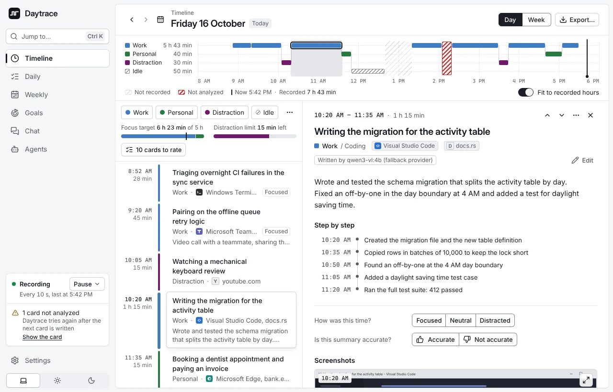
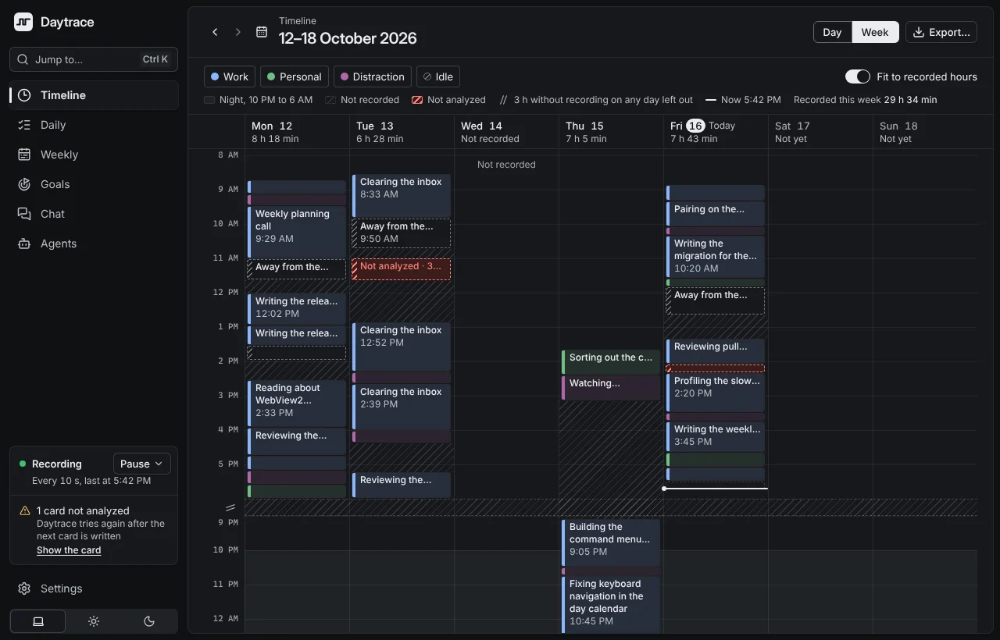
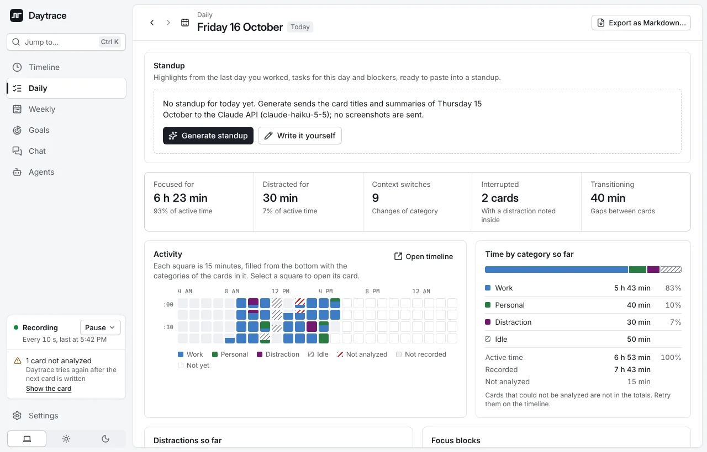
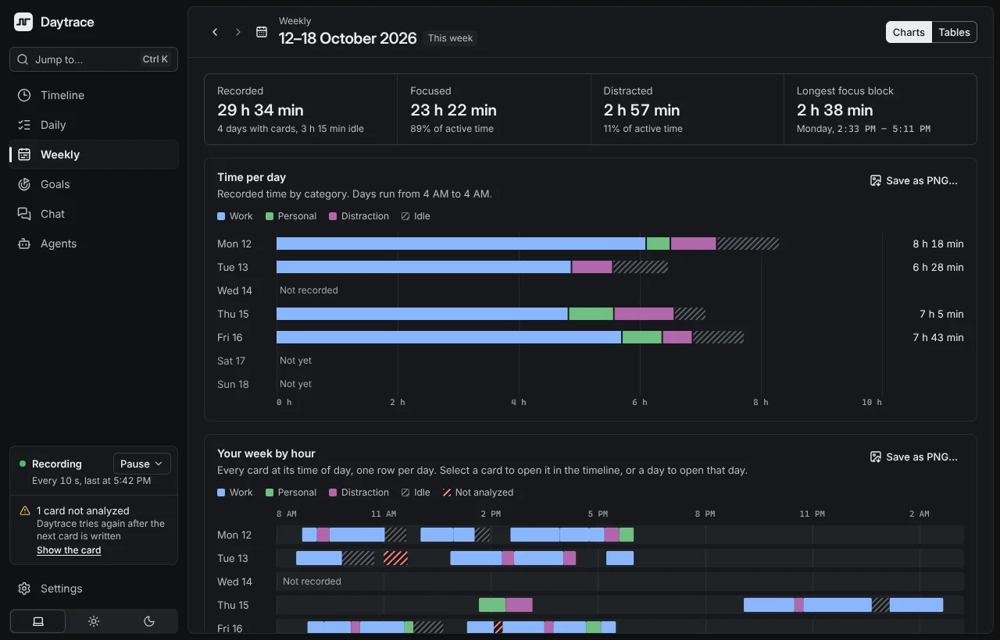
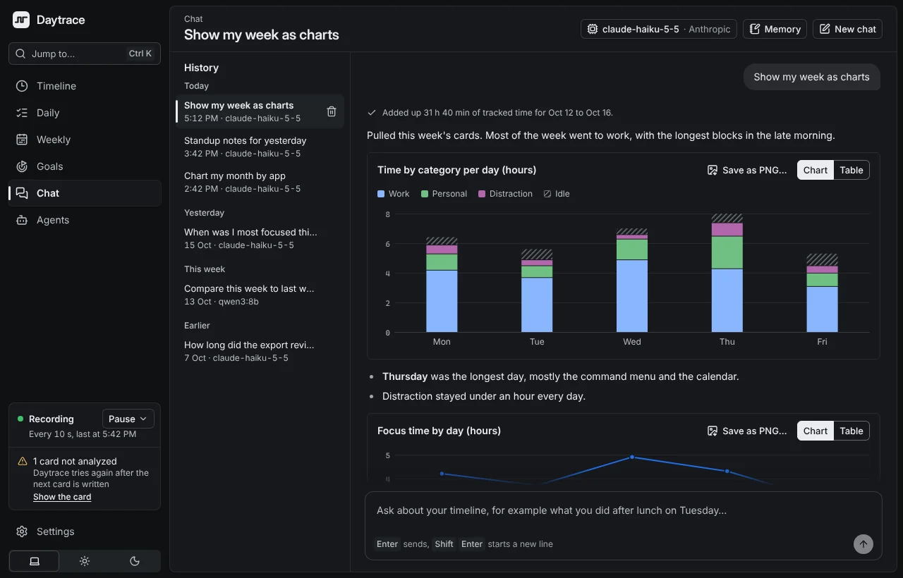
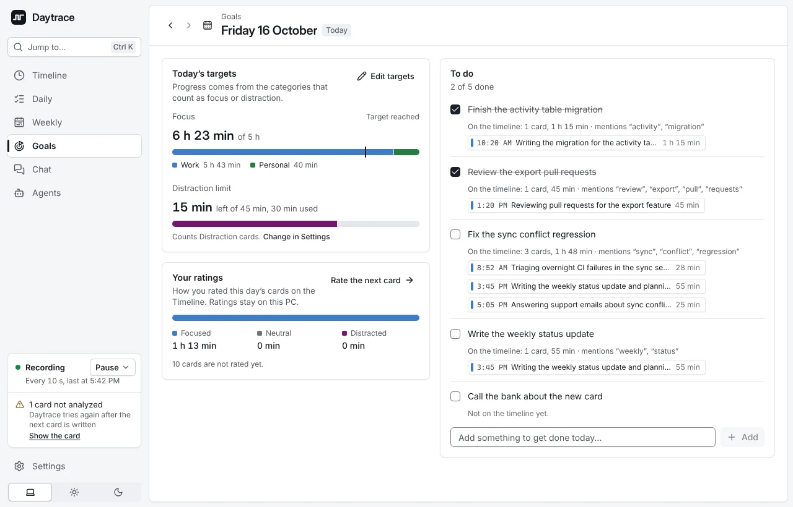
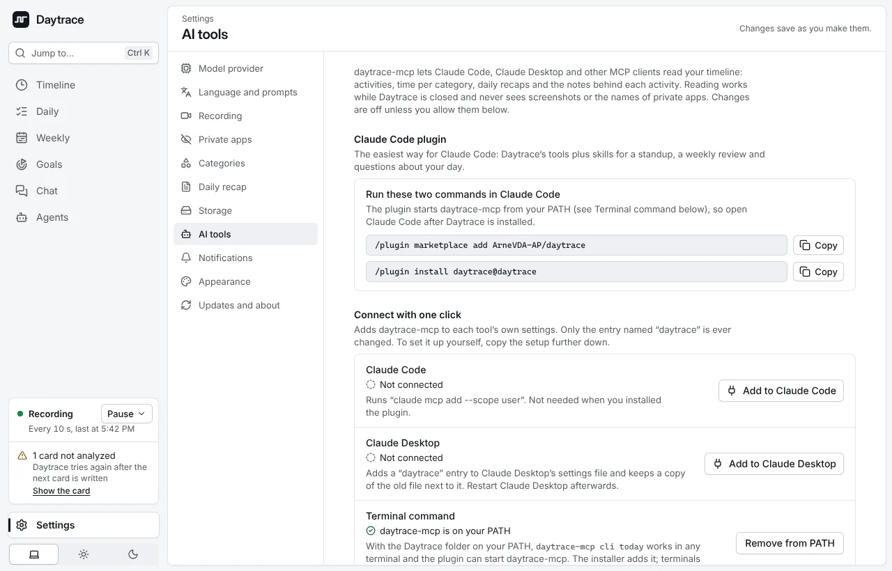

# Daytrace

**An automatic timeline of your workday, for Windows.**

<picture>
  <source media="(prefers-color-scheme: dark)" srcset="docs/images/hero-dark.webp">
  
</picture>

Daytrace takes a screenshot every few seconds, lets a vision model describe what you did every 15 minutes, and builds a timeline you can review, search and ask questions about. It is an unofficial Windows port of [Dayflow](https://github.com/JerryZLiu/Dayflow), which is macOS-only.

## Highlights

- **Timeline** of your day and week, with a summary and step-by-step log per activity
- **Daily standup** recap, **weekly** charts and **goals** for focus and distractions
- **Chat** with your timeline, with answers that cite the activities they come from
- **Your choice of model**: Claude API (with the cheaper Batch API), Ollama, LM Studio, or your Claude Code or Codex subscription
- **Private by default**: screenshots stay on your PC, private apps are never captured, time away from the PC costs nothing
- **MCP server and Claude Code plugin**, so your AI tools can read your day

## Install

There is no published release yet. Build the installer from source (Rust stable, Node 22 and the WebView2 runtime; see [docs/development.md](docs/development.md)), or download the installer from the artifacts of the latest [Build run](https://github.com/ArneVDA-AP/daytrace/actions/workflows/build.yml) (GitHub sign-in required).

1. Build it with `npm ci` and `npm run tauri build`, then run the installer in `src-tauri/target/release/bundle/nsis`. The installer is not code-signed yet: on "Windows protected your PC", choose **More info** → **Run anyway**.
2. The setup asks for a model provider and the apps Daytrace must never capture.
3. Select **Start recording**. Your first card appears after about 15 minutes.

Daytrace keeps running in the notification area when you close the window, and, once a release exists, updates itself.

## Screenshots

<table>
  <tr>
    <td width="50%"> <b>Week view</b></td>
    <td width="50%"> <b>Daily</b></td>
  </tr>
  <tr>
    <td> <b>Weekly</b></td>
    <td> <b>Chat</b></td>
  </tr>
  <tr>
    <td> <b>Goals</b></td>
    <td> <b>AI tools</b></td>
  </tr>
</table>

Screenshots show the built-in preview with sample data.

## Documentation

- [Features in detail](docs/features.md): capture, analysis, every section, pausing from a script, updates
- [Model providers](docs/providers.md): Claude, local models, Claude Code and Codex CLI, fallback
- [AI tools](docs/ai-tools.md): the `daytrace-mcp` server and CLI, the Claude Code plugin, one-click setup
- [Privacy and data](docs/privacy.md): what is stored, what is sent where, retention
- [Development](docs/development.md): building, testing, project layout, contributing

## Acknowledgements

Daytrace's analysis design, constants and prompts come from [Dayflow](https://github.com/JerryZLiu/Dayflow) by Jerry Liu (MIT). The rest is a new implementation in Rust and [Tauri](https://tauri.app). Daytrace is not affiliated with the Dayflow project.

## License

[MIT](LICENSE)
